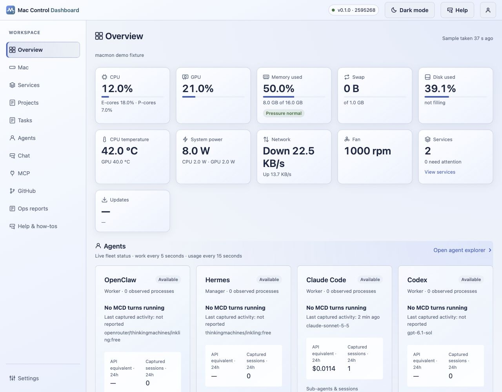

# Mac Control Dashboard (MCD)

Mac Control Dashboard (`mac-control`) is a local control center for the Mac mini M4 that monitors hardware health (CPU, GPU, memory, temperature, power, network, disk), tracks service health and crash-loop detection, manages a task board with agent dispatch (Claude Code, Hermes, OpenClaw, Codex) and execution approvals, provides agent chat with session resume, supports reviewed project planning with shared memory and bounded model routing, exposes read-only GitHub and operational report panels, and delivers durable failure alerts through an outbox with verification. It runs on a single FastAPI port (default 8800) with a Vue 3 frontend, binds to loopback by default (`127.0.0.1`), and supports optional private HTTPS remote access only through an operator-configured endpoint.

**MIT licensed · Provided as-is · Forks welcome.** You may use and customize the code and documentation for personal or commercial purposes under the [MIT license](LICENSE). No ongoing upstream development, updates, support or pull request review is promised. Users maintain their own installations and forks.

The preview uses synthetic data; it does not verify a live integration.

## Sections

- [Overview and alerts](docs/sections/overview.md) — fleet health, alert cards, updates
- [Mac health](docs/sections/mac.md) — charts (CPU, GPU, memory, temperature, power, network, disk), top processes, Tailscale status
- [Services](docs/sections/services.md) — LaunchAgent health, exit/status flags, crash-loop detection
- [Tasks](docs/sections/tasks.md) — vertical board, approvals, dependencies, lanes
- [Agents](docs/sections/agents.md) — fleet, usage/telemetry, billing, bounded routes
- [Chat](docs/sections/chat.md) — threads, turn dispatch, session isolation
- [Projects](docs/sections/projects.md) — reviewed planning, shared memory, assignment preference
- [Model routing](docs/sections/agents.md) — quotas, rates, execution catalogs
- [MCP](docs/sections/mcp.md) — server management, agent grants, Hermes access
- [GitHub](docs/sections/github.md) and [Reports](docs/sections/reports.md) — read-only panels
- [Help](docs/sections/help.md) — local guide chat, feature links, token-free
- [Profile and settings](docs/configuration/settings.md) — account, appearance, portable settings

## Tested on

Confirmed on [tested environments](docs/tested-environments.md): Mac mini M4, macOS 27.0.1, Python 3.12.13 (`/opt/homebrew/bin/python3.12`), Node v22.22.3, npm 10.9.8. Untested platforms are listed explicitly.

## Quick start

See [Getting started](docs/getting-started.md) for prerequisites and setup, then the [configuration guides](docs/configuration/settings.md) for sign-in, private remote access and profile preferences.

Once MCD is running, open **Setup wizard** from the header account menu, Settings or Help, or visit `/setup`. The [wizard guide](docs/SETUP_WIZARD.md) walks through Mac prerequisites, Google sign-in, Hermes and OpenClaw, a profile-owned OpenRouter key, subscription routes and the main menu. Integration prerequisites depend on the features you choose; the wizard distinguishes detected configuration from operator confirmations.

## Release and maintenance

This source release packages MCD for independent reuse under MIT. Installations use your own agent accounts, provider credentials and configuration. The tested environment is documented above; other platforms and external integrations require verification on your own host.

For your own changes, see the [fork development guide](CONTRIBUTING.md). [Development history](docs/development/CHANGELOG.md) and the [historical roadmap](docs/development/ROADMAP.md) describe the implementation and possible work for fork owners, without promising future delivery. Review the [security policy](SECURITY.md) and preserve the [third-party notices](THIRD_PARTY_NOTICES.md). Detailed how-tos live in [the documentation index](docs/README.md).
