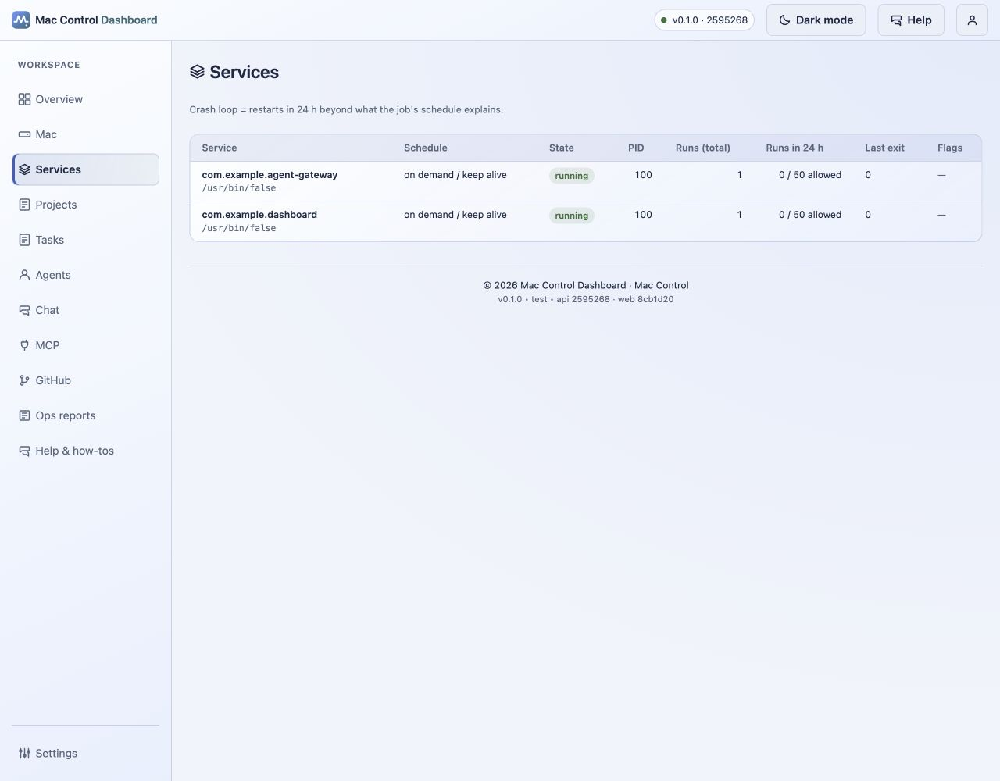

# Services

The Services page (`ServicesView.vue`) shows the health of every background `launchd` service whose label matches `MAC_CONTROL_SERVICE_PREFIXES`. It displays the latest snapshot per service label sorted by severity (`crash_loop` > `last_exit_nonzero` > healthy). It supports the decision: "Which service is in a crash loop or failed exit, how many runs occurred in the last 24 hours, and does it need a restart or schedule change before I open tasks or agents?"

## Purpose

For the operator: detect crash loops, unexpected exits, or missing services before investigating runs or tasks. For the user: understand which background agents (Hermes, OpenClaw gateway, dashboard, collector) are running, how busy they have been, and whether any require operator intervention. This page does not restart services; that requires an external `launchctl` action or a change to the service configuration outside MCD.

## Screenshots

-  — table with columns: Service, Schedule, State, PID, Runs (total), Runs in 24 h, Last exit, Flags. State chips (`running` in green / muted for other states). Crash-loop and non-zero exit flags appear as `ChipTag` elements with danger and warning tones.

## Controls

### Table (`class="data-table services"`)
- Sorted by severity descending (`data-severity`), then by label ascending (`label` split by dots with `<wbr>` breaks, program shown as muted sub-label).
- Each row (`key="domain/label"`) contains:
  - **Service** (`scope="row"`) — label parts and optional `program` path (e.g. `com.example.agent-gateway`).
  - **Schedule** — `schedule_label` derived from `run_interval_s` and `calendar` boolean.
  - **State** — `ChipTag` with tone `ok` for `running`, else `muted`.
  - **PID** — numeric process ID (`num(s.pid)`).
  - **Runs (total)** — `num(s.runs)`.
  - **Runs in 24 h** — `runs24(s)` format: `N / M allowed`. `allowed_runs_24h` is computed by `services_probe` (interval jobs get 20% margin; calendar jobs get 20-launch allowance).
  - **Last exit** — exit text (`Stopped by signal -N` for negative codes, else `Last exit N`).
  - **Flags** — array of `crash_loop` and/or `last_exit_nonzero`. Empty array shows a muted dash (`—`).
- No interactive sort buttons; the order is fixed by severity to surface failures first.

### Note text
- `Crash loop = restarts in 24 h beyond what the job's schedule explains.` — clarifies the definition of the `crash_loop` flag for the operator.

## Settings involved

- `.env` / `MAC_CONTROL_*` keys:
  - `MAC_CONTROL_SERVICE_PREFIXES` (default tuple: `ai.hermes.`, `ai.openclaw.`, `com.openclaw.`, `com.headroom.`, `com.operator.`). Only services with matching labels appear.
  - `MAC_CONTROL_DATA_DIR` (default `~/.mac-control`). Service snapshots are read from the SQLite database located there (`service_snapshot` table, migration-aware).
  - `MAC_CONTROL_LOG_LEVEL`.
- `alerts.toml` (`docs/configuration/alerts-toml.md`): the `[services]` section defines `enabled`, `window_seconds`, `excess_runs`, `calendar_allowance`, `sample_max_age_seconds`, and `recovery_samples`. These thresholds map directly to the `crash_loop` and `last_exit_nonzero` flags shown in the table.
- LaunchAgent (`docs/configuration/launchd.md`): the `.plist` label `com.operator.mac-control` and `RunAtLoad` / `KeepAlive` settings control whether services restart automatically; MCD only observes, it does not manage the agent.

Never include secret values (service paths that contain personal paths, tokens, or hostnames) in docs or screenshots.

## Troubleshooting

- **Service missing from table** — verify the `launchd` label contains one of the prefixes in `MAC_CONTROL_SERVICE_PREFIXES`. Check the `.plist` file (`ops/launchd/`) and the label in `systemctl --user list-units` or `launchctl list` independently.
- **Crash loop flag shown but service seems healthy** — the 24-hour window may include test launches or maintenance restarts. Inspect the `runs_24h` and `allowed_runs_24h` values. If the count is just above the allowance, the flag is correct; adjust schedule or reduce restarts externally.
- **Non-zero exit with no obvious failure** — `last_exit` is the exit code from the latest `launchd` termination. A non-zero code does not always mean a user-visible failure; some services exit cleanly with specific codes. Compare with service documentation (`docs/configuration/launchd.md`) before restarting.
- **PID shown as `—`** — the service snapshot has no running process (`state` not `running`). Check `launchctl` independently and inspect logs outside MCD.
- **Table never updates** — confirm `MAC_CONTROL_LOG_LEVEL` is not suppressing service probes and that the snapshot writer process (`services_probe`) has write access to the SQLite database at `MAC_CONTROL_DATA_DIR`.

## Related pages

- [Overview](overview.md) — service-attention count (`attention`) shown in the summary.
- [Mac health](mac.md) — resource charts that explain why a service may have crashed or been restarted.
- [Configuration: settings](../configuration/settings.md)
- [Configuration: alerts](../configuration/alerts-toml.md)
- [Alerts reference](../ALERTS.md)
- [Configuration: launchd](../configuration/launchd.md)
